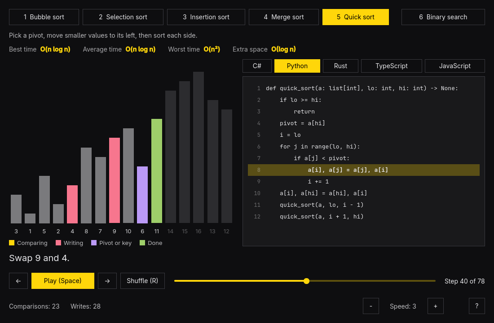

# Steplore

English | [正體中文](README.zh-TW.md)

**Learn algorithms one step at a time.**



Steplore runs an algorithm on sixteen numbers and shows every step: the bars are the list, the highlighted line is the code that just ran, and the sentence underneath says what it did. Step forwards and backwards at your own pace, or let it play.

It covers bubble sort, selection sort, insertion sort, merge sort, quick sort, and binary search. Every sort gets the same numbers, so their comparison and write counts can be compared. Each one shows its best, average, and worst time and the extra space it needs.

The code is shown in C#, Python, Rust, TypeScript, or JavaScript, each written to its own conventions. Switching language keeps the run where it is, so the same step can be read in each, and the choice is remembered.

Steplore follows the Omarchy theme and language live. It ships in English and Traditional Chinese.

## Shortcuts

| Key | Action |
| --- | --- |
| `Space` | Play or pause |
| `→` or `L` | One step forward |
| `←` or `H` | One step back |
| `Home` / `End` | Jump to the start or the end |
| `1` to `6` | Choose an algorithm |
| `T` / `Shift+T` | Next or previous programming language |
| `R` | Shuffle new numbers |
| `+` / `-` | Faster or slower |
| `?` | Show or hide the shortcuts |
| `Q` | Quit |

## Building

```bash
bin/build                                 # builds build/steplore
bin/test                                  # builds, then runs the tests offscreen
cmake --install build --prefix ~/.local   # adds Steplore to the app launcher
```

It needs `cmake`, a C++ compiler, and Qt 6 (`qt6-base`, `qt6-declarative`, `qt6-svg`, `qt6-wayland`), all part of Omarchy.

## License

MIT. The theme, translator, and build scaffolding come from Omarchy's own apps.
