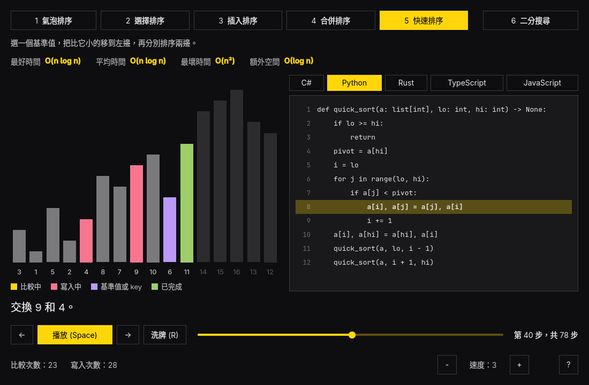

# Steplore

[English](README.md) | 正體中文

**一步一步，看懂演算法。**



Steplore 用十六個數字執行演算法，並顯示每一步：長條是串列，反白的那一行是剛執行的程式碼，下面那句話說明它做了什麼。可以照自己的步調前進、後退，也可以讓它自動播放。

內容包含氣泡排序、選擇排序、插入排序、合併排序、快速排序和二分搜尋。每種排序用的是同一組數字，所以比較次數和寫入次數可以互相對照。每種演算法都會顯示最好、平均、最壞時間，以及需要的額外空間。

程式碼可以用 C#、Python、Rust、TypeScript 或 JavaScript 顯示，各自照該語言的慣例寫成。切換語言時執行進度不變，所以同一步可以對照不同語言來讀，選過的語言也會記住。

Steplore 會即時跟著 Omarchy 的主題和語言切換，內建英文和正體中文。

## 快捷鍵

| 按鍵 | 功能 |
| --- | --- |
| `Space` | 播放或暫停 |
| `→` 或 `L` | 前進一步 |
| `←` 或 `H` | 後退一步 |
| `Home` / `End` | 跳到開頭或結尾 |
| `1` 到 `6` | 選擇演算法 |
| `T` / `Shift+T` | 下一種或上一種程式語言 |
| `R` | 換一組新數字 |
| `+` / `-` | 加快或放慢 |
| `?` | 顯示或隱藏快捷鍵 |
| `Q` | 離開 |

## 編譯

```bash
bin/build                                 # 編譯出 build/steplore
bin/test                                  # 編譯後在背景執行測試
cmake --install build --prefix ~/.local   # 把 Steplore 加進 app launcher
```

需要 `cmake`、C++ 編譯器和 Qt 6（`qt6-base`、`qt6-declarative`、`qt6-svg`、`qt6-wayland`），這些 Omarchy 都已內建。

## 授權

MIT。主題、翻譯器和建置骨架來自 Omarchy 自家的 app。
